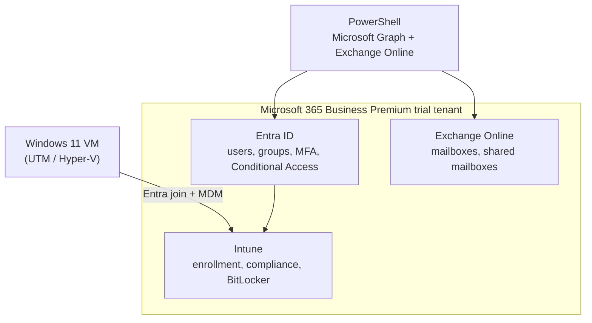

# Microsoft 365, Entra ID and Intune Lab

The cloud side of a modern help desk: onboarding and offboarding users in Microsoft 365, licensing, MFA with Conditional Access, shared mailboxes, and managing Windows 11 laptops with Intune (enrollment, compliance, BitLocker). Microsoft 365, Entra ID and Intune appear in most Toronto IT support and desktop support postings, so this lab covers the tasks a new hire actually gets assigned in week one.

## Architecture



## What's in the lab

| Task | How | Matches help desk ticket |
|---|---|---|
| Onboard new hires from a CSV | [`New-M365User.ps1`](scripts/New-M365User.ps1): user, usage location, license, groups, secure temp password | [T03](https://github.com/EbubeNnaemeka/helpdesk-ticketing-lab) |
| Offboard a leaver safely | [`Remove-M365User.ps1`](scripts/Remove-M365User.ps1): block sign-in, revoke sessions, convert mailbox to shared, auto-reply, remove groups, then licenses | T04 |
| Shared mailbox for a team | [`New-SharedMailbox.ps1`](scripts/New-SharedMailbox.ps1): Full Access + Send As | T21 |
| Who has which license / no MFA? | [`Get-M365AccessReport.ps1`](scripts/Get-M365AccessReport.ps1): licenses, MFA registration, last sign-in, disabled-but-licensed accounts | T15 |
| Require MFA, block legacy auth | [Conditional Access guide](docs/mfa-conditional-access.md) | T14, T15 |
| Enroll a Windows 11 device | [Intune enrollment guide](intune/enrollment.md) | - |
| Compliance + BitLocker | [Compliance and BitLocker guide](intune/compliance-and-bitlocker.md) | T22 |

All scripts support `-WhatIf`, skip work that's already done, and print a timestamped log to paste into the ticket.

**Status:** the scripts parse cleanly and every Microsoft Graph cmdlet and parameter was checked against Microsoft.Graph 2.41; Exchange Online cmdlets were checked against Microsoft's documentation. They haven't been run against a live tenant yet. Results below are filled in as I complete each part.

## Setup

See [`docs/tenant-setup.md`](docs/tenant-setup.md): trial tenant, securing the admin account (MFA + break-glass account), groups, modules, first run.

## Results

| Check | Result |
|---|---|
| Users onboarded from CSV | _fill in_ |
| Leaver offboarded, mailbox kept as shared | _fill in_ |
| Conditional Access MFA policy on (after report-only) | _fill in_ |
| Devices enrolled in Intune | _fill in_ |
| Compliance state of enrolled device | _fill in_ |
| BitLocker on, recovery key escrowed to Entra ID | _fill in_ |
| Recovery key retrieved for a simulated T22 | _fill in_ |

## Resume bullet (use once you have completed and verified the lab)

> Administered a Microsoft 365 tenant: automated onboarding and offboarding with Microsoft Graph PowerShell, enforced MFA through Conditional Access, and enrolled Windows 11 devices in Intune with compliance and BitLocker policies.

## Repo contents

```
├── README.md
├── new-hires.example.csv
├── scripts/
│   ├── New-M365User.ps1          onboarding
│   ├── Remove-M365User.ps1       offboarding
│   ├── New-SharedMailbox.ps1
│   └── Get-M365AccessReport.ps1  licenses, MFA, sign-ins
├── docs/
│   ├── tenant-setup.md
│   └── mfa-conditional-access.md
└── intune/
    ├── enrollment.md
    └── compliance-and-bitlocker.md
```
